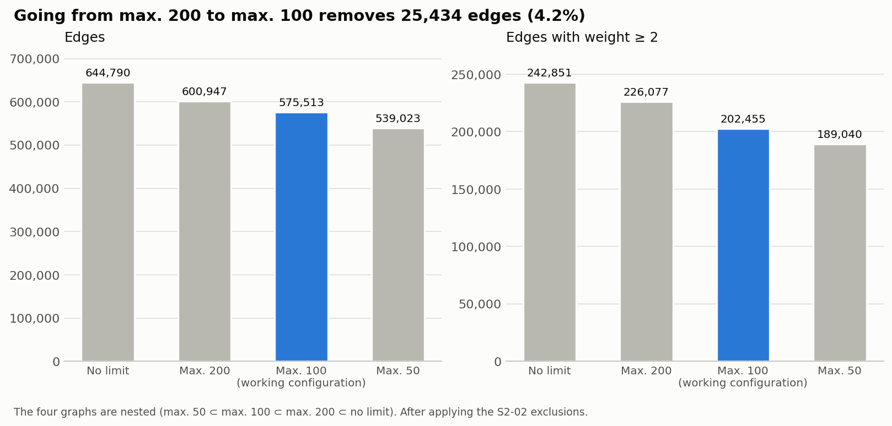
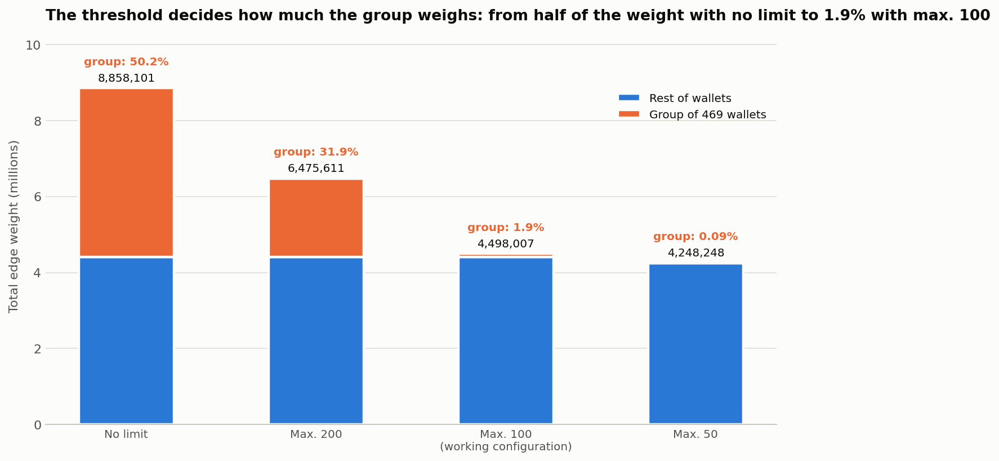
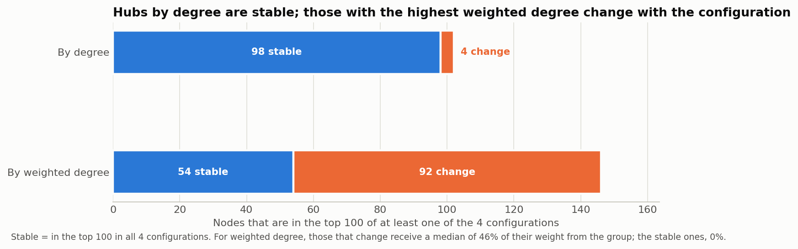

# S2-04 — Sensitivity of the graph to the voter filter

**Sprint:** Sprint 2
**Track:** A — Carlos
**Start date:** 2026-10-11
**Status:** Completed 2026-10-11
**Depends on:** S2-03 (confirmed threshold configurations)

Goal (according to the backlog): build and compare the graph under the current filter, the chosen alternatives and a baseline with no exclusion by activity; measure changes in edges, weights, main hubs and connected components; identify which results are stable and which depend on the threshold; record the processing limitations; choose and justify the working configuration, with the parameter adjustable without changing code.

> **Reproducibility note.** The edge files `results/S2-04/edges_<config>.csv` (about 22 MB each), `votes.csv`, `deployments.csv` (in `data/raw/`) and the voter cache (`data/processed/voters_cache.pkl`) are not included in the repository. To regenerate them, run from the repository root `python scripts/explore_shared_voters.py --max-daos <N> --format team --output results/S2-04/edges_<config>.csv` for each configuration (see step 2). Also not included: the one-off script used in step 1 to compare our edges with the team's pipeline (it imported the team's code from a local clone), and the backups of earlier versions of our script.

## Summary and decision

**Working configuration: `max100`** (wallets with more than 100 DAOs are excluded), confirmed by Carlos on 2026-10-11. It has been the default value of `explore_shared_voters.py` since that day; `max200` and `nolimit` are kept as sensitivity analysis.

- **Stable against the threshold:** connected components (a giant one of ~31,000 DAOs, one of 460 and ~1,500 small ones), hubs by degree (98 of 100 equal) and 75% of the edges.
- **Depends on the threshold:** the weights (the total weight falls 52% from `nolimit` to `max50`), the hubs by weighted degree from rank ~20 on (only 54 of 100 stable) and ~72,000 edges that exist only because of the group of 469 wallets.
- **Cause:** the wallets with more than 100 DAOs are all the S2-03 group; they contribute 50.2% of the weight of the no-limit graph and 31.9% of that of `max200`, but only 1.9% of that of `max100`.
- **Why `max100`:** it removes that pattern without losing edges independent of the group (the no-limit graph without the 469 wallets is contained in `max100`); `max50` would lose 34,391 legitimate edges.
- **Consequence with respect to the team's current configuration (`max200`):** 25,434 fewer edges and 30% less total weight.
- **Pending from others:** the decisions that affect the team repository are in the list at the end.

## Team decision (2026-10-12)

- **Default threshold = 100.** Our script has had it since 2026-10-11. In the team repository the equivalent is to change `max_daos=200` to `max_daos=100` in `filter_valid_voters` of `src/edge_generator.py` (line 34) and regenerate `edges.csv`.
- **Verified with the team's code:** with `max_daos=100` it produces 576,861 edges and total weight 4,503,001, identical to ours (575,513 of the graph + 1,348 excluded by S2-02). Checked with a one-off verification script (not included in the repository) that imports the team's code.
- **Parameterize `edge_generator.py` (proposal B): postponed.** `--max-daos` and `--output` are not added for now. In the meantime, the graphs of the other configurations (`max50`, `max200`, `nolimit`) are generated with our script (`--format team`), not with the repository's. It can be revisited later.

## Configurations (decided in S2-03)

| Configuration | Threshold (excluded if it has more DAOs) |
|---|---|
| `nolimit` | no threshold |
| `max200` | 200 (Sprint 1) |
| `max100` | 100 |
| `max50` | 50 |

---

## Context: the team repository

Repository: `TFG-Catalyst/Mapping-Blockchain-Ecosystem`, main branch, commit `194f6f1` (2026-10-05). It is a read-only clone reviewed on 2026-10-11.

| File | What it does |
|---|---|
| `src/data_cleaner.py` | Cleans the data: lowercase DAO ids and `voter` normalized per platform |
| `src/node_generator.py` | `deployments_clean.csv` → `data/processed/nodes.csv` |
| `src/edge_generator.py` | `votes_clean.csv` → `data/processed/edges.csv` (`source`, `target`, `shared_voters`). Filter: 2 to 200 DAOs per voter, with `max_daos=200` fixed in the code |
| `src/graph_builder.py` | `nodes.csv` + `edges.csv` → networkx graph. Silently discards the edges whose endpoint is not a node |
| `src/graph_sanity.py` | Nodes, edges, isolated nodes, connected components, degrees |
| `src/shared_voters.py` | Simplified version of our Sprint 1 script (fixed threshold 200) |

**Differences with our script**

| | Team | Ours |
|---|---|---|
| Columns of the edge CSV | `source`, `target`, `shared_voters` | `deployment_id_a`, `deployment_id_b`, `shared_voters_weight` (named `peso_votantes_compartidos` before the English version) |
| DAO ids | Lowercase | As they are (mixed case) |
| Threshold | Fixed in the code | `--max-daos` |
| Cache | No | Yes |
| Paths | Fixed (`data/processed/…`) | Configurable |

The repository code only reads its own `edges.csv`; no file reads our Sprint 1 CSV.

**The 1,348 S2-02 edges (checked with our CSVs):** there are 6 identifiers present in the edges and absent from `deployments.csv` (`aventus.eth`, `equilibria-xeqb.eth`, `gaiadao.eth`, `gauges.equilibria-xeqb.eth`, `mimo.eth`, `shardcoin.eth`, all Snapshot spaces). They affect 1,348 edges and 4,994 of weight, exactly the same in `nolimit`, `max200` and `max100`. *Correction after step 3:* in `max50` they are 1,287 edges and 4,727 of weight (the 61 remaining edges only exist because of wallets with 51-100 DAOs). They are the same 6 ids in the four configurations and the difference is small (less than 5%), so S2-02 shifts the absolute numbers almost equally and S2-04 does not need to wait for S2-02.

## Approach decision (A)

Reuse the team's graph layer and not rewrite it: we keep using our script (cache and threshold as a parameter) to generate the edges, export them in the team's format and compute the metrics with the logic of `graph_builder.py` and `graph_sanity.py`. Alternative B (move S2-04 to the repository and parameterize `edge_generator.py`) remains a proposal to the team.

---

## Step 1 — Verify that the team's pipeline and ours give the same edges (done)

The check was made with a one-off script that imported `edge_generator.py` and `data_cleaner.py` from the repository without modifying them. It writes no files and is not included in the repository.

**Part 1 — edge logic.** Our voter population (cache, 1,629,408 wallets, 2,721,671 wallet–DAO pairs, lowercase ids) is passed through the team's `filter_valid_voters(max_daos=200)` and `generate_dao_edges`, and compared with our CSV for threshold 200.

| | Team | Ours |
|---|---|---|
| Edges | 602,295 | 602,295 |
| Total weight | 6,480,605 | 6,480,605 |
| Only in one of the two | 0 | 0 |
| Common with different weight | 0 | |

**Result: identical.** (21 s)

**Part 2 — wallet normalization.** `votes.csv` (11,638,348 rows) is traversed and `data_cleaner.normalize_voter` is compared with our `extract_address` (named `extraer_direccion` before the English version).

- They differ in **919 rows (0.008%)**, all from Tally with Solana addresses (`solana:<network>:<address>`). The team keeps the address and lowercases it (a Solana address is case-sensitive); we leave the whole string.
- They affect 438 distinct identifiers. Only 1 wallet has 2 or more DAOs, and it contributes the same weight (1) with both normalizations.
- **Effect on the edges: none.** (35 s)

**Conclusion.** With the same population, the two pipelines generate the same edges with threshold 200. The only normalization difference changes no edge, although it would be advisable to unify it (proposal: do not lowercase Tally's Solana addresses).

**Caveats**

- The check uses the cache with our normalization; the team's cleaning has not been run end to end on `votes.csv` (it generates `votes_clean.csv`, ≈ 2.5 GB).
- Test environment: pandas 2.3.3; the repository pins pandas 3.0.6.
- Part 2 only compares the rows where the normalizations differ.

## Step 2 — Generate the edge CSV of each configuration, in the team's format (done)

**What was changed.** `scripts/explore_shared_voters.py` now has the option `--format {original,team}` (default `original`, which changes nothing compared with Sprint 1). With `team`:

- columns `source,target,shared_voters` (those read by `graph_builder.py`);
- lowercase DAO ids and each pair sorted alphabetically (A-B and B-A are the same edge);
- rows sorted by descending weight and, for equal weight, by ids: the output is reproducible;
- if two distinct ids merged when lowercased, the script stops instead of silently adding edges (in the current dataset it does not happen: 65,752 ids with and without lowercasing).

A backup of the previous script was kept outside the repository.

**How they are generated** (from the repository root; about 13-15 s each thanks to the cache):

```
python scripts/explore_shared_voters.py --max-daos 50  --format team --output results/S2-04/edges_max50.csv
python scripts/explore_shared_voters.py --max-daos 100 --format team --output results/S2-04/edges_max100.csv
python scripts/explore_shared_voters.py --max-daos 200 --format team --output results/S2-04/edges_max200.csv
python scripts/explore_shared_voters.py --max-daos 0   --format team --output results/S2-04/edges_nolimit.csv
```

**Verifications.**

- Regression: with `--format original` the file came out byte-identical to the previous one (`edges_shared_voters_max200.csv` and the Sprint 1 CSV). Since the English version, the header of the original format is `deployment_id_a,deployment_id_b,shared_voters_weight` (before: `…,peso_votantes_compartidos`); the data rows are unchanged.
- The `max200` in team format is identical to the Sprint 1 CSV once lowercased and sorted.
- Correct format in the 4 files: header, lowercase, `source < target`, no duplicates or self-loops.
- Nesting: edges(max50) ⊆ edges(max100) ⊆ edges(max200) ⊆ edges(nolimit), and the weight of an edge never drops when the threshold is widened.

| Configuration | Edges | Total weight | Maximum weight |
|---|---:|---:|---:|
| `max50` | 540,310 | 4,252,975 | 86,182 |
| `max100` | 576,861 | 4,503,001 | 86,230 |
| `max200` | 602,295 | 6,480,605 | 86,230 |
| `nolimit` | 646,138 | 8,863,095 | 86,230 |

| Step between configurations | New edges | Edges with greater weight |
|---|---:|---:|
| `max50` → `max100` | +36,551 | 53,192 |
| `max100` → `max200` | +25,434 | 3,336 |
| `max200` → `nolimit` | +43,843 | 25,810 |

**Reading (to be confirmed with the step 3 metrics).** The *total weight* is the sum of the weights of all edges, and a wallet with n DAOs contributes n(n−1)/2. That is why going from `max100` to `max200` adds few edges (+25,434) but almost 2 million of weight: few wallets, each with many pairs. The maximum weight (86,230) hardly changes between configurations, so the strongest edge does not depend on the threshold.

The CSVs are in `results/S2-04/`.

## Step 3 — Metrics per configuration (done)

**New script:** `scripts/graph_metrics.py`. It replicates the logic of `graph_builder.py` (the nodes are the DAOs of `deployments.csv` in lowercase; an edge only gets in if both of its endpoints are nodes) and the measures of `graph_sanity.py`, but reading the files it is given. Usage: `python scripts/graph_metrics.py` (options `--configs`, `--folder`, `--deployments`, `--output`). It only reads; it writes `results/S2-04/S2-04_metrics_by_config.csv`. It runs in about 5 s per configuration.

`networkx` (3.4.2) was installed in the working environment, the same library the team uses.

| Metric | `nolimit` | `max200` | `max100` | `max50` |
|---|---:|---:|---:|---:|
| Nodes (DAOs) | 86,489 | 86,489 | 86,489 | 86,489 |
| Isolated nodes | 49,224 | 49,243 | 49,256 | 49,396 |
| Connected nodes | 37,265 | 37,246 | 37,233 | 37,093 |
| Edges in the graph | 644,790 | 600,947 | 575,513 | 539,023 |
| Edges excluded (S2-02) | 1,348 | 1,348 | 1,348 | 1,287 |
| Edges with weight ≥ 2 | 242,851 | 226,077 | 202,455 | 189,040 |
| % edges with weight ≥ 2 | 37.66 | 37.62 | 35.18 | 35.07 |
| Total weight | 8,858,101 | 6,475,611 | 4,498,007 | 4,248,248 |
| Mean weight | 13.74 | 10.78 | 7.82 | 7.88 |
| Median weight | 1 | 1 | 1 | 1 |
| Maximum weight | 86,230 | 86,230 | 86,230 | 86,182 |
| Mean degree | 14.91 | 13.90 | 13.31 | 12.46 |
| Maximum degree | 10,237 | 10,237 | 10,237 | 10,124 |
| Connected components | 50,735 | 50,754 | 50,767 | 50,908 |
| Largest component (nodes) | 31,043 | 31,024 | 31,011 | 30,869 |
| Self-loops | 0 | 0 | 0 | 0 |

(Check: edges in the graph + excluded = rows of the CSV of each configuration, e.g. 644,790 + 1,348 = 646,138.)

**What is seen** (from `nolimit` to `max50`):

- **The structure hardly moves.** Connected nodes fall 0.5% (37,265 → 37,093), the largest component 0.6% and the number of components rises 0.3%. Only 172 DAOs become isolated when going from `nolimit` to `max50`.
- **The number of edges falls moderately:** −16% (644,790 → 539,023). Edges with weight ≥ 2 fall −22%.
- **Weights are the most sensitive:** the total weight falls to less than half (−52%) and the mean weight −43%. Between `max200` and `max100` the total weight falls 31% while the edges fall only 4%: wallets with 101-200 DAOs contribute very few new edges but a lot of weight.
- **The median weight is 1 in all four:** more than 62% of the edges come from a single shared voter, so the network is mostly "one wallet joins two DAOs".
- **The maximum degree (10,237) and the maximum weight (86,230) are equal** in `nolimit`, `max200` and `max100`; in `max50` they fall 1% and 0.06%.
- **Isolated nodes:** 57% of the DAOs have no edge in any configuration. It is a fact of the data, not of the filter, and it will be dealt with in step 6 (limitations).

These figures are descriptive. Which edges and which concrete hubs change is seen in steps 4 and 5.

## Step 4 — Hubs, components and comparison with the current configuration (done)

**New script:** `scripts/analyze_hubs_components.py` (it only reads; ~10 s). Same rule as `graph_builder.py`. The reference configuration is `max200` (the team's current one). It generates in `results/S2-04/`:

- `S2-04_hubs_by_config.csv`: top 20 per configuration and per criterion.
- `S2-04_nodes_by_config.csv`: degree and weighted degree of each node in the 4 configurations (the basis for step 5 and for S2-09).
- `S2-04_components_by_config.csv`: size of the 10 largest components.
- `S2-04_edge_comparison.csv`: edges that appear/disappear compared with `max200`.

Two definitions: **degree** = number of DAOs with which it shares voters; **weighted degree** = sum of the `shared_voters` of all its edges.

### Hubs

Top 10 by degree (identical and in the same order in the 4 configurations): arbitrum treasury (10,237 neighbors), arbitrum core (9,628), "test" (7,256, Tally, chain 10), Aave DAO, PancakeSwap, Uniswap (Snapshot), Stargate DAO, uniswap (Tally), Gitcoin and Arbitrum DAO.

| Nodes of the top-N in common with `max200` | `nolimit` | `max100` | `max50` |
|---|---:|---:|---:|
| Degree, top 10 / 20 / 50 / 100 | 10 / 20 / 50 / 100 | 10 / 20 / 50 / 100 | 10 / 20 / 49 / 98 |
| Weighted degree, top 10 / 20 | 10 / 20 | 10 / 19 | 10 / 19 |
| Weighted degree, top 50 | 42 | 50 | 49 |
| Weighted degree, top 100 | 84 | 70 | 70 |

Spearman correlation between configurations (nodes with edges in all 4, 37,093): degree ≥ 0.989 and weighted degree ≥ 0.989 in all pairs.

### Connected components

| | `nolimit` | `max200` | `max100` | `max50` |
|---|---:|---:|---:|---:|
| Components with ≥ 2 nodes | 1,511 | 1,511 | 1,511 | 1,512 |
| Sizes of the 6 largest | 31,043, 460, 39, 36, 34, 28 | 31,024, 460, 39, 36, 34, 28 | 31,011, 460, 39, 36, 34, 28 | 30,869, 460, 39, 36, 34, 28 |

Compared with `max200`, the largest component of `nolimit` contains the same nodes plus 19; that of `max100` loses 13; that of `max50` loses 155. No configuration adds nodes to the largest component that `max200` does not have.

### Edges compared with `max200`

| | `nolimit` | `max100` | `max50` |
|---|---:|---:|---:|
| Edges that disappear | 0 | 25,434 | 61,924 |
| Edges that appear | 43,843 | 0 | 0 |
| Common edges with different weight | 25,810 (4.29%) | 3,336 (0.58%) | 53,620 (9.95%) |
| Median weight of those that change, relative to `max200` | ×2.28 | ×0.22 | ×0.80 |

**Reading.**

- The hubs by degree and the general shape of the network (a giant component of ~31,000 DAOs, one of 460 and about 1,500 small ones) **do not depend on the threshold**.
- What changes is the **weight**, above all in intermediate positions of the weighted ranking (top 100: 70-84 nodes in common with `max200`) and in a small group of edges (3,336 between `max200` and `max100`) whose weight falls to a fifth. It is consistent with very active wallets (101-200 DAOs) that contribute a lot of weight to few edges. Which edges exactly they are and whether they belong to the group of 469 wallets is checked in step 5.
- The heaviest edge is arbitrum treasury ↔ arbitrum core (86,230 shared voters): they are two governors of the same DAO (Arbitrum), so that weight reflects an expected structural relationship and not an effect of very active wallets.

**Warning for S2-09.** The third hub by degree is called `test` (Tally, chain 10, 25 proposals, 78,724 unique voters, 240,303 votes). By size it does not look like a test DAO, and the name comes from the original data. It is necessary to review which DAO it really is before interpreting it in S2-09 (not verified).

## Step 5 — What is stable and what depends on the threshold (done)

**New script:** `scripts/analyze_stability.py` (it only reads; ~8 s). Run it from the repository root (it needs `data/raw/votes.csv`; it uses the cache to attribute weight to the group). It generates `S2-04_stability_bands.csv`, `S2-04_stability_edges.csv`, `S2-04_stability_hubs.csv` and `S2-04_stability_vs_no_group.csv` in `results/S2-04/`.

**Method.** Since the 4 configurations are nested, the weight of each edge is split by the activity of the wallets that contribute it: `max50` = wallets with 2-50 DAOs; `max100` − `max50` = wallets with 51-100; `max200` − `max100` = 101-200; `nolimit` − `max200` = more than 200. Then it is computed how much of each band comes from the 469 wallets of the S2-03 group. The script itself checks that the group never contributes more than its band (if it failed, it stops). Cross-check: the group makes up 31.86% of the weight of `max200`, the same as the 31.8% computed in S2-03.

### A. Weight by activity band (`nolimit` graph)

| Wallets with… | Weight | % of total | Group weight | % of the band that is from the group |
|---|---:|---:|---:|---:|
| 2-50 DAOs | 4,248,248 | 48.0% | 3,869 | 0.1% |
| 51-100 DAOs | 249,759 | 2.8% | 81,807 | 32.8% |
| 101-200 DAOs | 1,977,604 | 22.3% | 1,977,604 | 100% |
| more than 200 DAOs | 2,382,490 | 26.9% | 2,382,490 | 100% |

The 469 wallets of the group contribute **50.2%** of the total weight. All the weight of wallets with more than 100 DAOs is from the group, which confirms the hypothesis of step 4 (the 3,336 edges whose weight drops between `max200` and `max100`).

### B. Edge stability (weights measured in `nolimit`)

| Category | Edges | % edges | With weight ≥ 2 | % of weight | % of that weight from the group | Edges with all their weight from the group |
|---|---:|---:|---:|---:|---:|---:|
| Stable (same weight in all 4) | 484,968 | 75.2% | 145,756 | 14.2% | 0.04% | 5 |
| Growing (exists in all 4, weight increases) | 54,055 | 8.4% | 54,055 | 38.3% | 8.0% | 819 |
| New in `max100` | 36,490 | 5.7% | 3,543 | 5.5% | 92.7% | 2,099 |
| New in `max200` | 25,434 | 3.9% | 23,614 | 36.6% | 100% | 25,434 |
| New only in `nolimit` | 43,843 | 6.8% | 15,883 | 5.4% | 100% | 43,843 |

Notes: the % of weight in the "new in max100" row includes what those edges gain afterwards from wallets with more than 100 DAOs, which is why the group weighs so much there. Among the growing edges, the weight in `nolimit` is ×1.25 (median) and ×2.00 (90th percentile) that of `max50`; 24.4% is multiplied by 2 or more. Among the edges with weight ≥ 2, 60% (145,756 of 242,851) are stable.

### C. Hubs

| Top-N | By degree: in the 4 configurations | By weighted degree: in the 4 configurations |
|---|---:|---:|
| 10 | 10 | 10 |
| 20 | 20 | 19 (21 in the union) |
| 50 | 49 (51 in the union) | 42 (59 in the union) |
| 100 | 98 (102 in the union) | 54 (146 in the union) |

In the top 100 by weighted degree, the 54 stable nodes have a group weight of ~0% (median); the 92 that enter or leave have a median of 46.4%. Examples of nodes that rise from rank 236-2,965 in `max50` to 38-54 in `nolimit`, with 93-100% of their weight coming from the group: Metrox, 兔子洞投票任务专用, Strio, outofgas, 0xchen123, 0xchenliang, 0xchenhu, 0xueli, huxueli, kirillevans, connext社区dao, mxlcolm (all Snapshot spaces).

### D. Each configuration compared with "removing only the 469 wallets" (diagnosis)

| Configuration | Edges | Edges that would not exist without the group | % | Group weight | % of weight |
|---|---:|---:|---:|---:|---:|
| `nolimit` | 644,790 | 72,200 | 11.2% | 4,445,770 | 50.2% |
| `max200` | 600,947 | 28,357 | 4.7% | 2,063,280 | 31.9% |
| `max100` | 575,513 | 2,923 | 0.5% | 85,676 | 1.9% |
| `max50` | 539,023 | 824 | 0.15% | 3,869 | 0.09% |

The `nolimit` graph without the 469 wallets has 572,590 edges and weight 4,412,331. **It is entirely contained in `max100`** (which only adds 2,923 more edges), whereas `max50` removes 34,391 edges from it that exist without any support from the group (legitimate edges of wallets with 51-100 DAOs).

### Conclusion of step 5

- **Stable against the threshold:** the giant component and the rest of the components (step 4), the hubs by degree (98 of 100 in the 4), the top 10-20 by weighted degree and 75% of the edges (with weight ≥ 2: 60%).
- **Depends on the threshold:** the weights (above all the total and mean weight), the hubs by weighted degree from rank ~20 on (only 54 of 100 are stable) and about 72,000 edges (11%) that exist only because of the group of 469 wallets, of which 69,277 appear between `max200` and `nolimit`.
- **Cause:** almost all the dependence comes from the wallets with more than 100 DAOs, which are entirely the S2-03 group. The 51-100 band contributes few problematic edges (a third of its weight is from the group) and many legitimate ones.
- **Caveat:** the group was defined by behavior (containment ≥ 0.8 against the list of the most active wallet) and is partly circular. That 469 wallets share DAOs does not prove a single operator or bots. "No group" is a diagnosis, not a working configuration.

## Step 6 — Limitations, working configuration and parameter (done)

### 6a. Processing limitations (measured in the working environment: 2 cores, 3.9 GB of RAM)

| Operation | Time | Peak memory |
|---|---:|---:|
| First read of `votes.csv` (2.4 GB, 11,638,349 rows) and creation of the cache | ~44 s | — |
| Generate the edges of one configuration from the cache (`nolimit` / `max100`) | 6.8 s / 5.8 s | 1.19 GB / 1.16 GB |
| Hubs and components of the 4 configurations (`analyze_hubs_components.py`) | 9.2 s | 0.48 GB |

- **Cost is not what limits the threshold.** The work grows as n(n−1)/2 per wallet (the most active wallet has 353 DAOs, 62,128 pairs), but the no-limit total is 8,863,095 pairs and is solved in seconds. The filter is justified by data quality, not by performance. The total weight of each graph matches the pairs processed (4,252,975 in `max50`, 4,503,001 in `max100`, 6,480,605 in `max200`, 8,863,095 with no limit).
- **The threshold affects very few wallets:** of 388,891 wallets with 2 or more DAOs, between `max50` and `nolimit` only 434 change (0.11%), and even so they are 52% of the weight of the no-limit graph.
- **The cache** (`voters_cache.pkl`, 147 MB) is only valid while `votes.csv` does not change (checked by size and date). If it changes, it is recomputed automatically.
- **The team's pipeline has not been measured** (it loads everything in pandas and `graph_builder.py` goes through the rows one by one); it is not claimed to be slower or faster.
- **Visualization:** the full graph (86,489 nodes, ~600,000 edges) cannot be drawn; `network_visualization.py` is already limited to the 100 strongest edges among the 50 nodes with the highest degree.
- **Working environment:** calls are limited to 180 s and the cache created in an earlier run is reused. On a normal computer these operations have no such limit.

### 6b. Limitations of the data and the method

- **57% of the DAOs (49,224 of 86,489) have no edge in any configuration.** It is not an effect of the filter. Of them, 20,743 have no voter in `votes.csv` and 28,481 have voters but none of them votes in another DAO (24,658 with a single voter). By platform, 52% of Snapshot and 78-82% of Aragon, DAOhaus, Realms and Tally are isolated.
- **The weight counts wallets, not people or voting power.** A person with several wallets weighs more than they should. Between 62 and 65% of the edges have weight 1.
- **The group of 469 wallets is defined by behavior** (containment ≥ 0.8 against the list of the most active wallet): it is partly circular and does not prove a single operator or bots.
- **S2-02 exclusions:** 6 Snapshot ids are not in `deployments.csv` (1,287-1,348 edges, less than 0.3%). Pending to be resolved in S2-02.
- **Normalization of Tally-Solana voters:** the team's pipeline and ours differ in 919 rows; it changes no edge.
- **Node names:** the name comes from the original data and can mislead (e.g. `test`, 78,724 voters). Pending verification in S2-09.
- **Off-chain Snapshot votes:** the Etherscan dates of a wallet are not vote dates.
- **The threshold grid has 4 points.** S2-03 found no natural cut in the activity distribution, so the exact threshold is a decision, not a finding.

### 6c. Working configuration (confirmed by Carlos, 2026-10-11)

**Decision: `max100`** (wallets with more than 100 DAOs are excluded). `nolimit`, `max200` and `max50` are kept as sensitivity analysis.

| Criterion | `nolimit` | `max200` (current) | **`max100`** | `max50` |
|---|---:|---:|---:|---:|
| Weight of the group of 469 in the total weight | 50.2% | 31.9% | **1.9%** | 0.09% |
| Edges that would not exist without the group | 72,200 | 28,357 | **2,923** | 824 |
| Edges independent of the group that are lost | 0 | 0 | **0** | 34,391 |
| Components and hubs by degree | equal | equal | **equal** | equal |

Arguments:

1. **It cuts exactly where the pattern starts.** All the wallets with more than 100 DAOs (319) belong to the group; none is left out. Setting the limit at 100 removes that pattern and nothing else (the weight of the 101-200 and more-than-200 bands is 100% from the group).
2. **It does not lose what is independent of the group.** The no-limit graph without the 469 wallets (572,590 edges) is entirely contained in `max100`, which only adds 2,923 more edges. `max50` loses 34,391 edges without support from the group.
3. **The wallets with 51-100 DAOs that are not in the group (76) do not copy its pattern.** Their containment against the reference list has median 0.00 and maximum 0.12; 74 of 76 are below 0.1. This does not prove they are people, but it does show they do not replicate the group's list. 39 wallets of the group with 51-100 DAOs remain in the graph (residue of the 1.9% of the weight).
4. **It does not change what was already stable:** components and hubs by degree are equal in the 4 configurations.
5. **Performance does not force cutting further.**

What changes with respect to `max200` (the team's current configuration): 25,434 fewer edges, 30% less total weight and a different part of the ranking by weighted degree (in the top 100 only 70 nodes coincide).

Safeguards: keep the `max200` and `nolimit` results as sensitivity in the TFG report; do not present the group as bots; 100 is a point of the grid, not a natural cut of the activity distribution.

### 6d. Parameter adjustable without changing code

- **Today:** `python scripts/explore_shared_voters.py --max-daos N` (0 = no limit), with `--format team` for the repository format. The metrics, hubs and stability scripts read the CSVs by configuration name.
- **Default value of the script:** changed from `200` to `100` (constant `DEFAULT_MAX_DAOS_PER_VOTER`; a backup of the earlier version was kept outside the repository). Checked: without `--max-daos` the script generates exactly `edges_max100.csv`, and with `--max-daos 200` it reproduces the Sprint 1 CSV byte for byte.
- **For the team repository:** proposal B (`--max-daos` and `--output` in `edge_generator.py`) was postponed on 2026-10-12; only the fixed value is changed from 200 to 100.

## Figures (2026-10-16)

**Script:** `scripts/make_s2_04_figures.py`. It only reads the CSVs in `results/S2-04/` (it recomputes nothing) and writes the 3 PNGs. Before drawing it checks that the weight per activity band, accumulated, matches the total weight of each configuration; if it does not match, it stops.

**Figure 1: edges per configuration.** Going from max. 200 to max. 100 removes 25,434 edges (4.2%). The edges with weight ≥ 2 go from 226,077 to 202,455.



**Figure 2: total weight and group weight.** The group of 469 wallets contributes 50.2% of the weight with no limit, 31.9% with max. 200, 1.9% with max. 100 and 0.09% with max. 50. It is the figure that justifies the choice of `max100`.



**Figure 3: hub stability.** Of the 102 nodes that are in the top 100 by degree of some configuration, 98 are in all four. By weighted degree it is 54 of 146. The 92 that change receive a median of 46% of their weight from the group; the 54 stable ones, 0%. In figures 2 and 3 orange marks the effect of the group.



## Pending in S2-04

- [x] Step 2: generate the edge CSV of each configuration in the team's format (`source`, `target`, `shared_voters`, lowercase ids).
- [x] Step 3: metrics per configuration with the logic of `graph_builder.py` (edges, edges with weight ≥ 2, connected nodes, mean and maximum weight), showing the S2-02 exclusions.
- [x] Step 4: hubs (degree and weighted degree), connected components and comparison with the current configuration.
- [x] Step 5: stable edges and hubs versus threshold-dependent ones.
- [x] Step 6: processing limitations, justified working configuration and default value of the parameter.
- [x] Notify the team and propose alternative B (parameterize `edge_generator.py`): done; the team decides to postpone it (2026-10-12).
- [x] Comment in the team group the change of the default value to `max_daos=100` (Carlos, 2026-10-12).
- [ ] Change `max_daos=200` to `max_daos=100` in `src/edge_generator.py` of the repository and regenerate `edges.csv` (pending to apply in the repository).
- [ ] Talk to Rodrigo (S2-05/06): working configuration `max100`, name of the parameter (`--max-daos`) and CSV format.
- [ ] Decide with the team who maintains `edge_generator.py` (it has the 200 fixed) and unify the normalization of Tally-Solana wallets (proposal: do not lowercase).
- [ ] `.gitignore` for `*.pkl` and `__pycache__/`; check that `pandas`, `matplotlib` and `networkx` are installed wherever the scripts are run.
- [x] Verify which DAO the node `test` is (third hub by degree): it is Optimism Governance (Agora), verified on Optimistic Etherscan; see `S2-09_ecosystem_hubs.md`.
- [ ] Optional: check the metrics of this document against the team's real `build_graph()` (the current results replicate its logic, they do not run its code).

## Changelog

| Date | Change | Files |
|---|---|---|
| 2026-10-11 | Review of the team repository; decision on approach A | this document |
| 2026-10-11 | Step 1: verification of edge and normalization equivalence | one-off script (not included in the repository) |
| 2026-10-11 | Step 2: `--format team` option and 4 CSVs per configuration | `scripts/explore_shared_voters.py`, `results/S2-04/edges_*.csv` |
| 2026-10-11 | Step 3: metrics per configuration; corrected the S2-02 exclusions figure in `max50` (1,287, not 1,348) | `scripts/graph_metrics.py`, `results/S2-04/S2-04_metrics_by_config.csv` |
| 2026-10-11 | Step 4: hubs, components and edge comparison compared with `max200` | `scripts/analyze_hubs_components.py`, `results/S2-04/S2-04_*.csv` |
| 2026-10-11 | Step 5: stability by activity bands, edges and hubs; diagnosis compared with removing the group | `scripts/analyze_stability.py`, `results/S2-04/S2-04_stability_*.csv` |
| 2026-10-11 | Step 6: measured limitations; working configuration `max100` confirmed; default value of `--max-daos` changed from 200 to 100; S2-04 completed | `scripts/explore_shared_voters.py`, this document |
| 2026-10-12 | Change of `max_daos` to 100 commented in the team group; node `test` verified | this document |
| 2026-10-16 | Three figures for the deliverable (edges, group weight, hub stability) | `scripts/make_s2_04_figures.py`, `results/S2-04/S2-04_fig1_edges.png`, `S2-04_fig2_group_weight.png`, `S2-04_fig3_hub_stability.png`, this document |
| 2026-10-16 | English version for the repository: file names, script names, options, configuration label `sinlimite` → `nolimit` and CSV columns translated; numbers use English formatting | all files of S2-04 |
