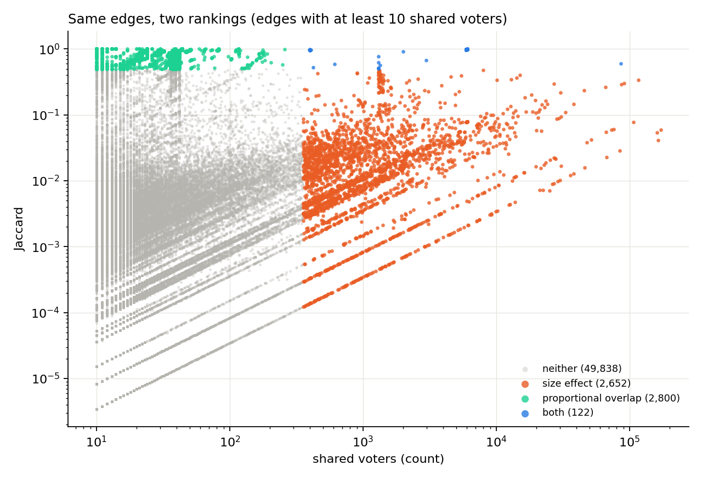
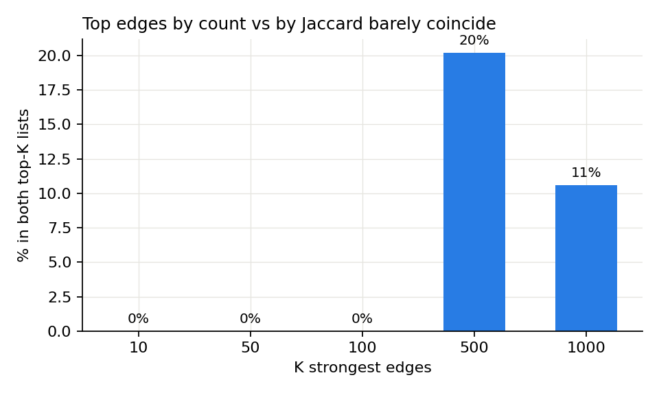
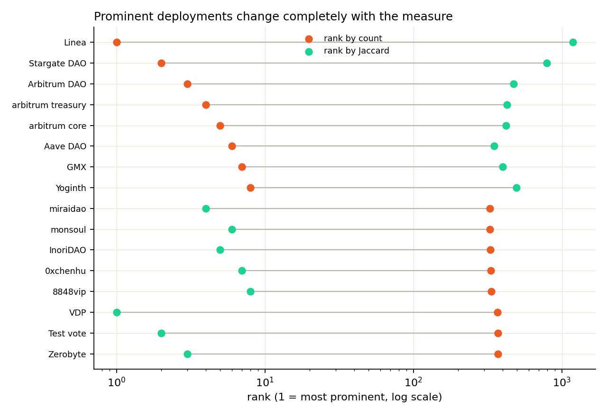

# S3-07 - Normalization and shared-author analyses on the complete votes (Zenodo v5)

**Status:** Rerun completed on v5; pending review by the team.
**Reference graph:** S3-05 (`max_daos = 100`, Zenodo v5). The full pipeline was run again from `data/raw/` on a second
computer and gives exactly the figures of S3-05 (67,340,666 votes, 86,495 nodes, 700,304 edges, weight 10,682,356,
35,277 isolated nodes, 36,263 components, largest component 46,722).
**Scope:** S2-05, S2-06 and S2-07 repeated with the same code, constants (`MIN_SHARED_VOTERS = 10`, top 5% cut) and
thresholds. **Criteria:** those of S3-06 (a share is STABLE if it moves at most 2 percentage points; a count that must
stay zero is STABLE if it stays zero; absolute counts grow with the 5.8 times more votes and are marked SCALE).

## Summary

| Result of Sprint 2 | On v5 |
| --- | --- |
| S2-05: Jaccard weights are consistent | **Stable**: all checks pass on the 700,304 edges |
| S2-06: strongest edges by count and by Jaccard do not coincide | **Stable** for top 10, 50 and 100 (0 in common); top 500 goes from 7% to 20.2% (**changed**, explained below); top 1000 is 10.6% (10%) |
| S2-06: four types of edge | **Stable**: each share moves 0.31 points or less |
| S2-06: prominent deployments depend on the measure | **Stable**: none is in both top 10 or both top 50 |
| S2-07: shared-author network | **Stable**: identical (139,679 authors, 28,359 edges, weight 37,919) |

## S2-05: Jaccard weights

The pipeline (`src/pipeline/jaccard_weights.py`) already checks the sizes, the counts and hand-recalculated pairs. Example:
`crypto435.eth` and `linea-build.eth` share 170,988 voters out of a union of 2,906,437 (Jaccard 0.0588).
`analysis/s3_07_v5_comparison/check_jaccard_consistency.py` repeats the checks on all the edges (result in
`results/S3-07/S2-06/S3-07_jaccard_consistency.txt`): `union = voters_source + voters_target - shared`,
`jaccard = shared / union`, `shared` not above the smaller community, `union` not below the bigger one, and `shared_voters`
equal to `edges.csv`. Edges breaking each rule: 0. Community sizes come from `votes.csv`, not from the metadata counters
(S2-05, S3-04).

## S2-06: how normalization changes the prominent relationships

**Script:** `analysis/s2_06_normalization_effect/normalization_comparison.py`, unchanged. It always writes to
`docs/figures/S2-06_*.png`, so the new figures were renamed `S3-07_fig*.png` and the v4 ones restored with git. The v4 values
are those written in `S2-06_normalization_effect.md` (not recomputed).

| | v4 | v5 | Verdict |
| --- | ---: | ---: | --- |
| Edges with at least 10 shared voters | 41,759 | 55,412 | SCALE (x1.33) |
| Size effect (high count, low Jaccard) | 1,975 (4.73%) | 2,652 (4.79%) | STABLE |
| Proportional overlap (high Jaccard, low count) | 1,983 (4.75%) | 2,800 (5.05%) | STABLE |
| Both | 115 (0.28%) | 122 (0.22%) | STABLE |
| Neither | 37,686 (90.25%) | 49,838 (89.94%) | STABLE |
| Top 10 / 50 / 100 edges in common | 0 / 0 / 0 | 0 / 0 / 0 | STABLE |
| Top 500 edges in common | 7% | 20.2% | CHANGED |
| Top 1000 edges in common | 10% | 10.6% | STABLE |
| Deployments in common, top 10 / 50 | 0 / 0 | 0 / 0 | STABLE |

"High" means the top 5% of the edges (cuts on v5: 355 shared voters, Jaccard 0.50), so the shares are close to fixed by
construction; what carries information is the overlap between rankings and which edges and deployments appear.





**Why the top 500 changes.** The 101 edges in both top-500 lists have 5,918 to 6,070 shared voters and Jaccard 0.975 to
0.998 (balsam, tarpon, hotstock, hinny, caiman, electricite...). It is the cluster of near-identical spaces of S2-06 and
S3-06, now with about 6,000 voters (4,500 in v4), so more of its edges enter the top 500 by count. The conclusion holds: the
two measures select different edges, and only the near-identical clusters coincide.

| Type | Pair | Shared voters | Jaccard |
| --- | --- | ---: | ---: |
| Size effect | Crypto435 - Linea | 170,988 | 0.0588 |
| Size effect | PancakeSwap - Aave DAO | 7,609 | 0.038 |
| Both | arbitrum treasury - arbitrum core | 86,229 | 0.604 |
| Both | balsam - tarpon | 6,070 | 0.998 |
| Proportional overlap | Cube stone - Work Club 1 | 190 | 0.856 |
| Proportional overlap | Oldmaster - miniworld | 257 | 0.989 |

arbitrum treasury - arbitrum core (Jaccard 0.60 in v4) was a size effect and is now "both": the same value is above the
Jaccard cut, which is 0.50 on v5.

**Prominent deployments** (strength = sum of the weights of the edges with at least 10 shared voters).



- Top 10 by count: Linea, Stargate DAO, Arbitrum DAO, arbitrum treasury, arbitrum core, Aave DAO, GMX, Yoginth, Crypto435,
  Optimism Governance. Top 10 by Jaccard: VDP, Test vote, Zerobyte, miraidao, InoriDAO, monsoul, 0xchenhu, 8848vip,
  huxueli, kirillevans. None is in both lists (nor in the top 50 of both).
- The large organizations are at ranks 349 to 1,187 by Jaccard (350 to 800 in v4): the leaders by Jaccard are spaces linked
  to many near-identical spaces.

| S2-09 hub | Rank by count / by Jaccard, v4 | v5 |
| --- | --- | --- |
| Lido | 20 / 351 | 51 / 353 |
| ENS | 34 / 392 | 22 / 591 |
| balsam | 19 / 145 | 36 / 97 |
| tarpon | 21 / 144 | 38 / 94 |

**Interpretation** (unchanged from Sprint 2): neither measure alone identifies the important deployments. Count rewards size;
summed Jaccard rewards belonging to groups of near-identical communities, whose cause (one operator or a shared audience) is
unknown. Both are kept and clusters are flagged before reading either ranking as influence.

## S2-07: shared-author network

**Script:** `analysis/s2_07_shared_authors/shared_authors.py`, unchanged. It uses only `proposals.csv` and `deployments.csv`.

| | v4 | v5 | Verdict |
| --- | ---: | ---: | --- |
| Authors | 139,679 | 139,679 | STABLE |
| DAOs with an author | 66,619 | 66,619 | STABLE |
| Edges | 28,359 | 28,359 | STABLE |
| Total weight | 37,919 | 37,919 | STABLE |

The result is identical although the proposal table changed (Snapshot 244,886 to 231,845; Tally 37,839 to 32,016): the
network counts distinct (author, DAO) pairs, so removing proposals only matters if it removes the only proposal of an
author in a DAO. Why they were removed could not be verified without the v4 file.

| Platform | Proposals with author | DAOs | DAOs in author edges |
| --- | ---: | ---: | ---: |
| Snapshot | 100% | 71,958 | 6,361 (8.8%) |
| DAOhaus | 100% | 3,459 | 1,007 (29.1%) |
| Aragon | 100% | 2,402 | 575 (23.9%) |
| DAOstack | 100% | 58 | 53 (91.4%) |
| Tally | 0% | 4,394 | 0 |
| Realms | 0% | 4,224 | 0 |

Edges by platform pair: Snapshot - Snapshot 13,794; DAOhaus - DAOhaus 7,321; DAOhaus - Snapshot 3,145; Aragon - Aragon
1,655; the rest under 800 each. Files: `results/S3-07/S2-07/`.

## How to rerun

From the repository root, with the v5 files in `data/raw/` (PowerShell):

```
python -m src.pipeline.run_pipeline --max-daos 100                        # about 40 minutes
python -m analysis.s3_07_v5_comparison.check_jaccard_consistency          # S2-05
python -m analysis.s2_06_normalization_effect.normalization_comparison    # S2-06 (overwrites docs/figures/S2-06_*.png)
Copy-Item docs\figures\S2-06_scatter_count_vs_jaccard.png docs\figures\S3-07_fig1_scatter_count_vs_jaccard.png
Copy-Item docs\figures\S2-06_top_k_overlap.png docs\figures\S3-07_fig2_top_k_overlap.png
Copy-Item docs\figures\S2-06_rank_change_deployments.png docs\figures\S3-07_fig3_rank_change_deployments.png
git restore docs/figures                                                  # recovers the v4 figures
python -m analysis.s2_07_shared_authors.shared_authors                    # S2-07
```

## Limits and open points

- Tally and Realms proposals have no author: 8,618 DAOs (10% of the nodes) cannot appear in the author network. A missing
  author is a gap in the data, not an absence of relationship.
- The edge `mimo.eth` - `parallel-protocol.eth` (weight 6) is partly an artefact: Mimo was renamed Parallel Protocol and 11
  proposals appear under both names (S3-04), so their 5 distinct authors count as shared. That is 5 of 37,919 (0.013%) of the
  total weight. The rule is not changed in this sprint; merging both names is left for the next iteration.
- `MIN_SHARED_VOTERS = 10` and the 5% cut are choices of the team.
- The S2-06 limit about Snapshot undercoverage no longer applies: v5 has 99.8% of the declared Snapshot votes (S3-04).
