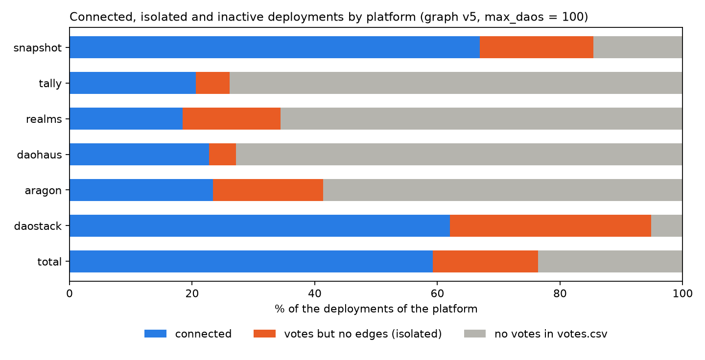
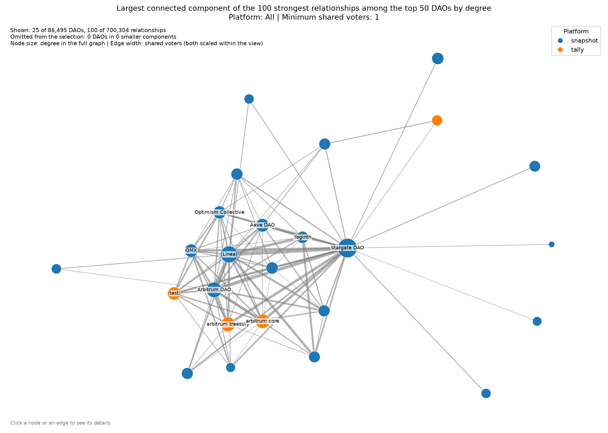

# S3-08 - Final figures and descriptive tables

**Status:** Figures of S2-10 and S2-11 saved; tables generated from code. Pending review by the team.
**Data:** Zenodo v5, reference graph of S3-05 (`max_daos = 100`).
**Code:** `analysis/s3_08_outputs/`. **Output:** `docs/figures/S3-08_*.png` and `results/S3-08/`.

## Naming of the figures

Every figure is named `S<sprint>-<task>_fig<number>_<description>.png`, as S3-06 already does. The figures of
Sprint 2 were built on v4 and keep their names; the ones of Sprint 3 are on v5.

| File in `docs/figures/` | Task | Data | Shows |
| --- | --- | --- | --- |
| `S2-03_activity_histogram.png` | S2-03 | v4 | Activity of the voters |
| `S2-04_fig1_edges.png`, `fig2_group_weight.png`, `fig3_hub_stability.png` | S2-04 | v4 | Sensitivity to the threshold |
| `S2-06_scatter_count_vs_jaccard.png`, `S2-06_top_k_overlap.png`, `S2-06_rank_change_deployments.png` | S2-06 | v4 | Count against Jaccard |
| `S2-14_raw_vs_jaccard.png` | S2-14 | v4 | Raw and Jaccard weights |
| `S3-06_fig1_threshold.png`, `fig2_activity.png`, `fig3_hub_ranks.png` | S3-06 | v5 | v4 against v5 |
| `S3-07_fig1_scatter_count_vs_jaccard.png`, `fig2_top_k_overlap.png`, `fig3_rank_change_deployments.png` | S3-07 | v5 | S2-06 on v5 |
| `S3-08_fig1_isolation_by_platform.png` | S2-10 | v5 | Connected, isolated and inactive deployments |
| `S3-08_fig2_graph_view_all.png` | S2-11 | v5 | View of the strongest relationships among the top DAOs |

The Sprint 2 files were not renamed or replaced, because other documents link to them. Whether the v5 figures
replace the v4 ones in the process document is a decision for the team.

## Figures of S2-10 and S2-11 (not saved before)



`make_figures.py` draws the figure from table 4 below. S2-10 had only tables in a notebook.



`make_figures.py` uses `src/visualization/network_visualization.py` without changing it (the shared file is not
modified) and saves what that script would show in a window. The view is the default one: the 100 strongest
relationships among the 50 DAOs with most connections, showing the 25 DAOs they join. The text "click a node" of the
image does not work in a file.

## Descriptive tables

Generated by `make_tables.py` (CSV files in `results/S3-08/`). Votes are counted in
`votes_clean.csv`; the cleaning step stops if it loses a row, so the count is the one of `votes.csv`.

**Table 1. Rows per file and platform**

| platform | deployments | proposals | votes |
| --- | ---: | ---: | ---: |
| snapshot | 71,952 | 231,845 | 64,585,436 |
| tally | 4,394 | 32,016 | 1,597,604 |
| realms | 4,224 | 21,153 | 1,067,333 |
| daohaus | 3,459 | 46,936 | 51,129 |
| aragon | 2,402 | 15,746 | 26,833 |
| daostack | 58 | 3,573 | 12,331 |
| total | 86,489 | 351,269 | 67,340,666 |

**Table 2. Coverage of votes.csv against the declared votes** (`votes_count` of `deployments.csv`)

| platform | declared | rows in votes.csv | coverage (%) |
| --- | ---: | ---: | ---: |
| snapshot | 64,697,595 | 64,585,436 | 99.8 |
| tally | 1,440,390 | 1,597,604 | 110.9 |
| realms | 1,067,333 | 1,067,333 | 100.0 |
| daohaus | 51,129 | 51,129 | 100.0 |
| aragon | 26,833 | 26,833 | 100.0 |
| daostack | 12,331 | 12,331 | 100.0 |
| total | 67,295,611 | 67,340,666 | 100.1 |

**Table 3. Size of the data at each step**

| Step | Measure | Value |
| --- | --- | ---: |
| 1. Rows of votes.csv | vote rows | 67,340,666 |
| 2. Distinct (voter, DAO) pairs | pairs | 9,250,601 |
| 2. Distinct (voter, DAO) pairs | distinct voters | 6,509,336 |
| 3. Filter `max_daos = 100` | voters excluded (more than 100 DAOs) | 321 |
| 3. Filter `max_daos = 100` | voters in one DAO only (cannot create edges) | 5,543,929 |
| 3. Filter `max_daos = 100` | voters that create edges | 965,086 |
| 4. Nodes | nodes | 86,495 |
| 4. Nodes | nodes not in the catalogue | 6 |
| 5. Edges (shared voters) | edges | 700,304 |
| 5. Edges (shared voters) | total weight | 10,682,356 |
| 6. Jaccard weights | edges with Jaccard | 700,304 |
| 7. Graph | connected nodes | 51,218 |
| 7. Graph | isolated nodes | 35,277 |

**Table 4. Isolation by platform** (method of S2-10)

| platform | nodes | connected | votes, no edges | no votes | isolated among deployments with votes (%) |
| --- | ---: | ---: | ---: | ---: | ---: |
| snapshot | 71,958 | 48,148 | 13,349 | 10,461 | 21.7 |
| tally | 4,394 | 905 | 244 | 3,245 | 21.2 |
| realms | 4,224 | 780 | 673 | 2,771 | 46.3 |
| daohaus | 3,459 | 787 | 151 | 2,521 | 16.1 |
| aragon | 2,402 | 562 | 432 | 1,408 | 43.5 |
| daostack | 58 | 36 | 19 | 3 | 34.5 |
| total | 86,495 | 51,218 | 14,868 | 20,409 | 22.5 |

## Validation

Tables checked against other sources, all matching: votes, deployments and coverage per platform (`data_dictionary.md`);
pairs 9,250,601, deployments with votes 66,086, nodes, edges, weight, isolated nodes, components and the isolation table
(`S3-05_graph_v5.md`); distinct voters 6,509,336 and voters with more than 100 DAOs 321 (`S3-06_filter_and_hubs_on_v5.md`).
The counting code also gives the same numbers as an independent implementation on a sample of 430,000 votes.

## How to regenerate

From the repository root, after `python -m src.pipeline.run_pipeline --max-daos 100`:

```
python -m analysis.s3_08_outputs.make_tables     # tables 1 to 4 (the first run takes about 20 minutes)
python -m analysis.s3_08_outputs.make_figures    # S3-08_fig1 and S3-08_fig2 (building the graph takes about 3 minutes)
```

The first run reads `votes_clean.csv` twice and saves the counts in `results/S3-08/votes_per_deployment.csv` and
`voters_summary.csv`; later runs reuse them (delete them to count again).

## Open points

- Tally has 110.9% coverage in table 2 (1,597,604 rows in `votes.csv` against 1,440,390 declared). The cause is not known and
  should be asked to the team before explaining it in the report.
- Whether the v5 figures replace the v4 ones and whether the Sprint 2 figures are renamed (the links of the documents would
  have to be updated).
- S3-12 will change the graph view (neighbour highlight, Jaccard on edges); `make_figures.py` will then need a check.
